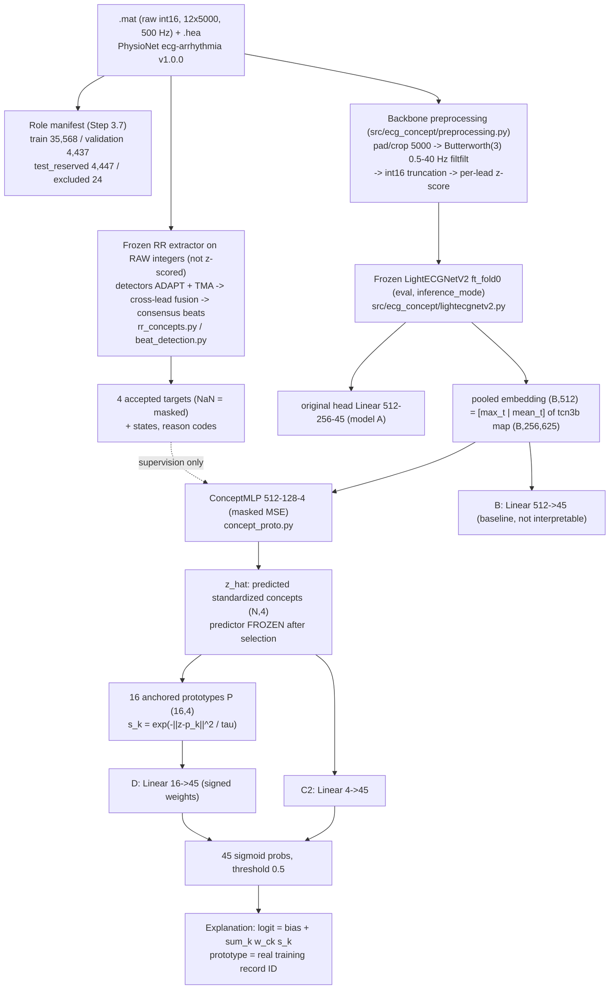
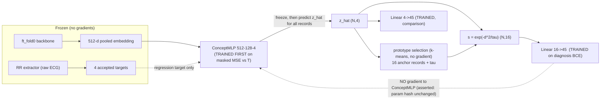

# PROJECT HANDOVER — ECG-Concept-Prototype

*Generated 2026-11-19 by read-only inspection of `C:\Users\lenovo\Desktop\ECG-Concept-Prototype` (plus read-only looks at two sibling project folders). Nothing in the project was modified to produce this file.*

**Evidence tags used throughout:** **[V]** verified from source code, a saved result file, or a log I read · **[I]** reasonable inference · **[P]** planned / proposed only, not implemented · **[U]** unverified / could not be recovered.

---

## 0. Read this first (15-line orientation)

1. **What it is:** a research project to build an *interpretable* 12-lead ECG diagnosis model: a frozen pretrained CNN backbone (**LightECGNetV2**, checkpoint `ft_fold0`) → a small set of **clinical concepts** → **concept-grounded prototypes** → 45-label diagnosis + explanations.
2. **What actually exists [V]:** a verified, recovered backbone + inference pipeline; a reproducible dataset/split/threshold audit; a frozen **RR-timing concept extractor** (ventricular rate + three "10-second RR statistics"); and a first **concept → anchored-prototype → diagnosis** experiment, evaluated on the **validation role only**.
3. **The concept set is tiny:** only **4 automatically-derived rhythm-timing concepts** (mean-RR rate, RR CV, NRMSSD, robust successive-difference). No P-wave, PR, QRS duration, QT, ST, axis, amplitude or morphology concepts exist. They are *not* expert-validated.
4. **Headline result [V]:** four timing concepts predicted from the embedding reach R² 0.98 (rate) / 0.68–0.91 (irregularity) vs a constant, but as the only inputs to the diagnosis head they cost ~0.17 macro-AUROC versus a linear head on the 512-d embedding (0.757 vs 0.923; original head 0.959). Prototypes add only ≈ +0.009 macro-AUROC over the concept-only head.
5. **Integration:** concept module and prototype module are a **sequential, separately-trained pipeline** (concept predictor trained first, then frozen; prototype similarities are computed from its predictions; only a linear 16→45 head is trained on diagnosis loss). There is **no joint training and no gradient flow** from diagnosis loss into the concept predictor, **no embedding bypass**.
6. **Prototypes are anchored, not learned:** 16 actual training records chosen by deterministic k-means in predicted-concept space. Similarity = `exp(−d²/τ)`.
7. **Test fold:** historically evaluated once in Step 3.5 (for the recovered backbone, not for any concept model). **Nothing from Steps 4.x touches test data.** The held-out test role is reserved.
8. **Git state:** last commit is `2453c21 "step 3.5"` (2026-10-13). Code for Steps 3.6–4.4 is **staged (`A`) but not committed** at inspection time; **`results/` is git-ignored**, so *no result artifact is version-controlled*.
9. **Environment:** Windows 11, Python **3.14.6**, numpy 2.5.4, scipy 1.18.1, torch 2.12.0+cu126, GTX 1650 (4 GB), 12 CPU threads. No scikit-learn / pandas / matplotlib / ECG packages. Use `.venv\Scripts\python.exe -I …`.
10. **Where development stopped:** end of **Step 4.4–6.1** (2026-11-11 ~12:55): first validation results and report exist. Next supported step: add concepts that carry what timing cannot (QRS duration, frontal axis), validated against references first (§13).

---

## PART 1 — EXECUTIVE SUMMARY

### 1.1 What is this project?
A concept-grounded prototype ECG classifier. README (`README.md`) states the research goal as: *"concept-grounded prototype learning for interpretable 12-lead ECG diagnosis"*, with planned pipeline *Raw ECG → pretrained LightECGNetV2 → ECG representation → clinical concept layer → concept vector → prototype reasoning → diagnosis + explanation*. [V]

### 1.2 Problem and objective
Deep ECG classifiers are accurate but opaque. The aim is a model whose decision pathway runs through human-meaningful concepts and case-based prototypes so explanations are *faithful to the actual prediction mechanism*. Long-term goal (stated by the user in prompts, not in the repo): a publishable, competitive model; ProtoECGNet (PTB-XL, macro-AUROC 0.9132) was named as a reference comparator, explicitly **not** directly comparable (different data/labels/split). [V that it was stated; paper itself not read]

### 1.3 Approach and components
| Component | Role | Status |
|---|---|---|
| LightECGNetV2 backbone (`models/pretrained/lightv2_ft_fold0.pt`) | frozen feature extractor; 512-d pooled embedding + original 45-way head | recovered & verified [V] |
| Concept extractor (`src/ecg_concept/rr_concepts.py`, `beat_detection.py`) | raw ECG → 4 RR-timing concepts + masks/states | built, piloted, frozen [V] |
| Concept predictor (`ConceptMLP` 512→128→4) | embedding → predicted standardized concepts | trained, 3 seeds [V] |
| Concept-only head (C2) | Linear 4→45 on predicted concepts | trained [V] |
| Anchored-prototype head (D) | 16 anchored prototypes, RBF similarity, Linear 16→45 | trained [V] |
| Controls | mask-only head; extracted-target head; constant concept predictor; embedding linear head (B) | trained [V] |

### 1.4 Current status & next step
Validation-only first experiment complete (`results/step4_4/experiment_report.md`). Next logical step: extend the concept set with delineation-based concepts (QRS duration, frontal axis), validating the extraction against public/expert references (plan in `results/step4_2/`), then rerun the same frozen experiment protocol with the enlarged concept set (§13).

---

## PART 2 — RESEARCH OBJECTIVE AND METHODOLOGY

* **Clinical/technical problem:** automated multi-label 12-lead ECG diagnosis (45 classes: rhythms, conduction, morphology/ST-T changes) where clinicians need to know *why*.
* **Why explainability:** clinical trust and error analysis; the project explicitly requires explanations that are *computationally faithful* (what the model computes) — *not* merely post-hoc attributions. The same author's earlier work used post-hoc SHAP (see §11), which is the contrast.
* **Why concepts:** a concept bottleneck forces the decision to flow through named quantities (rate, irregularity, later intervals/axis) that clinicians can inspect and, in principle, intervene on.
* **Why prototypes:** case-based explanations ("this ECG's concept profile resembles training record X") that anchor abstract concept space to real examples.
* **How they complement (intended) [P/V]:** concepts give a low-dimensional, interpretable coordinate system; prototypes give exemplars and similarity-based reasoning in that coordinate system. Implemented complement: prototype similarities are computed *only* from predicted concepts (so explanations cannot rely on a hidden embedding path).
* **Expected contribution [P]:** an end-to-end pretrained-backbone → concept → prototype pipeline with faithfulness checks and a rigorous, leakage-aware evaluation protocol.
* **Original objective vs implemented:** original = clinical concept layer (intervals, morphology, etc.) + prototype reasoning with explanations. **Implemented = only four timing concepts and fixed (anchored) prototypes; no learned prototypes, no concept intervention study, no clinician evaluation, no morphology concepts.**

---

## PART 3 — COMPLETE MODEL ARCHITECTURE (as implemented)

### 3.1 Pipeline (actual)


### 3.2 Module-by-module

| Module | Purpose | Input → Output (shapes) | Algorithm / key params | Source |
|---|---|---|---|---|
| Record index / roles | select train/val records, reject test | role manifest → `record_index.csv` | `results/step3_7/prospective_role_manifest.csv` | `scripts/step4_4_cache.py::stage_index` |
| Backbone preprocessing | exact original training preprocessing | `(12,N)` int16 → `(12,5000)` float32 | zero-pad/crop; `butter(3,[0.5,40]/250,'band')`+`filtfilt`; **int16 truncation after filtering (quirk preserved)**; per-lead z-score, eps 1e-8 | `src/ecg_concept/preprocessing.py::preprocess/load_ecg` |
| LightECGNetV2 | backbone | `(B,12,5000)` → logits `(B,45)`; `forward_features` returns `feature_map (B,256,625)`, `pooled (B,512)`, `hidden (B,256)`, `logits` | LeadAttention (SE over 12 leads, 12→6→12); 3 depthwise-separable stems k=3/7/15 (16+16+32=64 ch) + 1×1 proj+BN+PReLU, AvgPool2; TCN stages: tcn1a/b (64 ch, k13, dil 1,2), pool, tcn2a/b (64→128, k13, dil 4,8), pool, tcn3a/b (128→256, k9, dil 1,2); global max‖mean → Linear 512→256 → ReLU → Dropout .4 → Linear 256→45. **376,108 trainable params** (380,332 incl. BN buffers) | `src/ecg_concept/lightecgnetv2.py` |
| Checkpoint loading | safe load | `.pt` → model | `torch.load(weights_only=True)`, `strict=True`, `.eval()` | `src/ecg_concept/inference.py::load_model` |
| Beat detectors | R-peak times | `(N,)` lead → sample indices | **ADAPT** (Pan–Tompkins-*style*: band 5–15 Hz → derivative² → 150 ms MWI → adaptive signal/noise thresholds, 0.25 frac, search-back 1.66×RR) and **TMA** (Elgendi-*style* two moving averages: band 8–20 Hz, windows 97 ms/611 ms, β=0.08). Localisation: argmax\|5–25 Hz band-passed signal\| within ±80 ms; refractory 200 ms. **Own SciPy implementations, not verified reproductions.** | `src/ecg_concept/beat_detection.py::detect_adaptive, detect_tma` |
| Cross-lead fusion | consensus beats per detector | per-lead beat dict → `(times, support)` | leads **I, II, V1–V6** (8 non-redundant channels; II = I+III, aVR+aVL+aVF = 0); greedy cluster, members within **50 ms of cluster's first member** (no chaining), ≥3 leads, median time, refractory 200 ms | `beat_detection.py::fuse_leads, NONREDUNDANT_LEADS` |
| Detector matching | agreement between detectors | two time arrays → one-to-one pairs | optimal assignment (`linear_sum_assignment`), tol 50 ms | `beat_detection.py::match_one_to_one` |
| Concept extraction | values, states, reasons | `(12,N)` raw → dict | see Part 4 | `src/ecg_concept/rr_concepts.py::extract_record/extract_path/extract_many/rr_concepts/lead_quality`, frozen `CONFIG` |
| Concept predictor | embedding → 4 concepts | `(N,512)` std. → `(N,4)` std. | `ConceptMLP`: Linear(512,128)‑ReLU‑Linear(128,4); masked per-concept MSE; AdamW lr 1e‑3, wd 1e‑4, batch 256, ≤100 ep, patience 10 on val masked MSE | `src/ecg_concept/concept_proto.py::ConceptMLP, masked_mse, fit_head` |
| Prototype construction | anchors | `z_hat` of train fully-accepted records → 16 anchor records | deterministic k-means (farthest-point init from point nearest mean; Lloyd ≤100 it), anchor = nearest distinct real training record to each centre | `concept_proto.py::kmeans_det, anchor_records` |
| Similarity / τ | RBF activations | `(N,4)` → `(N,16)` | `s_k=exp(−‖z−p_k‖²/τ)`; τ = max(median over all train-eligible records of squared distance to nearest prototype, 1e‑6) ⇒ τ ≈ 0.118–0.123 | `concept_proto.py::similarities, tau_rule` |
| Prototype head | diagnosis | `(N,16)` → `(N,45)` | `ProtoHead = Linear(16,45)`; `contributions()` returns `(N,45,16)`; BCE; AdamW lr 1e‑2 | `concept_proto.py::ProtoHead` |
| Experiment runner | all training/eval | merged cache → CSVs, checkpoints | see Part 8 | `scripts/step4_4_train.py` |

### 3.3 Verified integration facts
* The **only** thing feeding the prototype head is the 16-d similarity vector, built from the *frozen predicted concepts* (`ProtoHead.fc.in_features == 16`, asserted; test `TestPrototypes.test_logits_equal_bias_plus_contributions_and_head_sees_only_similarities`). [V]
* The embedding enters **only** the concept predictor (and baseline B). No hidden/residual path, no mask inputs to the proposed models. [V]
* The concept extractor and the backbone are fully independent (extractor reads raw integers; backbone reads the filtered/z-scored tensor). Extracted targets are used only as regression supervision. [V]

---

## PART 4 — CONCEPT LEARNING MODULE (in THIS project)

### 4.1 Definition
Concepts are **manually specified, explicitly-computed signal-processing statistics** (not discovered), then **learned to be predicted from the backbone embedding** (supervised regression). [V]

For accepted beat times `t_1<…<t_n` (consensus of detectors A and B), `RR_i = t_{i+1}−t_i` (s), `m = n−1`:

```
rate_mean_bpm   = 60 / mean(RR)                         (primary; = 60·m/(t_n − t_1))
rate_median_bpm = 60 / median(RR)                       (secondary; diagnostic only, never a model input)
rr_cv           = std(RR, ddof=1) / mean(RR)
rr_nrmssd       = sqrt(mean(diff(RR)^2)) / mean(RR)
rr_mad_succ     = median(|diff(RR)|) / median(RR)
```
Irregularity statistics require `m ≥ 3`; rate requires ≥ 2 beats. Missing = NaN (never 0). **The irregularity outputs are descriptive 10-second RR statistics on *all* detected RR intervals — not conventional HRV, not NN-based, not expert-validated.** (`src/ecg_concept/rr_concepts.py` docstring.)

### 4.2 The 12 questions
| # | Question | Answer |
|---|---|---|
| 1 | How defined? | Four fixed formulas above; extractor `CONFIG` frozen (params SHA-256 `4f5e41ea05c53bd3…`, `results/step4_3/extraction_config.json`). |
| 2 | Manual / discovered / joint? | **Manual definitions; predictor learned by supervised regression; not jointly learned with prototypes or diagnosis.** |
| 3 | Explicit extraction or learned? | **Both**: explicit extraction (training targets, `accepted_*`) and learned prediction from embedding (`ConceptMLP`). Only the *predicted* concepts feed the diagnostic heads. |
| 4 | Mapping to clinical concepts | Rate ↔ ventricular rate; CV/NRMSSD/MAD ↔ beat-to-beat irregularity. **Physiological accuracy is unestablished** (no reference annotations exist locally; see §9, §12). |
| 5 | P-wave, PR, QRS duration, QT/QTc, ST, morphology, rhythm? | **Only rhythm-related timing (rate, RR irregularity). P-wave: no. PR: no. QRS duration: no. QT/QTc: no. ST: no. Axis/amplitude/morphology: no** (all *deferred*; evidence review in `results/step4_2/`). |
| 6 | Signal processing? | Yes: two detectors, cross-lead fusion, one-to-one matching, quality checks. Raw-integer input, detector band-passes used for timing only. |
| 7 | How scores computed? | Extraction: formulas above. Predictor: standardized with **train-only** mean/std of *accepted* targets; predictions inverse-transformed for error reporting. |
| 8 | Supervision? | Yes: accepted extractor targets (masked MSE). Missing targets are masked, never zero-filled. Train accepted: rate 34,343; CV/NRMSSD/MAD 34,341 (of 35,568). |
| 9 | Bottleneck? | **Yes, hard bottleneck for models C2 and D**: diagnosis heads see only predicted concepts (4-d) or prototype similarities derived from them. Baseline B (embedding) is *not* part of the interpretable model. |
| 10 | Influence on classification | C2: `logit_c = b_c + Σ_j w_cj ẑ_j`. D: `logit_c = b_c + Σ_k w_ck s_k(ẑ)`. |
| 11 | Presentation of concept explanations | Prototype table with predicted & extracted concept values **in original units**, anchor training ID, supporting/opposing classes (`results/step4_4/prototype_summary.csv`). **No visualisation/UI exists.** |
| 12 | Status | See 4.3. |

### 4.3 Quality / mask logic (implemented) [V]
Per record states: `ACCEPTED` / `UNCERTAIN` / `UNAVAILABLE` for the rate group and the irregularity group; reason codes `NONFINITE_LEAD, FLAT_LEAD, CLIPPING_SUSPECT, INSUFFICIENT_USABLE_LEADS, INSUFFICIENT_BEATS, INSUFFICIENT_BEATS_FOR_IRREGULARITY, DETECTOR_DISAGREEMENT, LOW_LEAD_SUPPORT, LOW_USABLE_LEADS, STRUCTURAL_SHAPE, READ_ERROR`.
* Flat lead: ≥80% samples equal one value (engineering convention); clipping: int16 limits or ≥4-sample plateau at the lead extreme with steep flanks (fixed after a test found baseline minima mis-flagged).
* Abnormal rhythm/morphology **never** masks; unusual RR intervals are never removed; diagnosis, age, sex, timestamp and ID never enter a value or mask (interface test).
* Uncertain values are kept separate from accepted values; only `accepted_*` is used for supervision.
* Coverage on 40,005 records: train accepted 96.6% (UNCERTAIN 514, UNAVAILABLE 711); validation 96.6% (66 / 83). `results/step4_4/coverage_summary.csv`, `coverage_by_label.csv`, `failure_summary.json`.

### 4.4 Concept evaluation (agreement with extractor targets, **not** physiological accuracy)
Mean of 3 seeds, **validation**, `results/step4_4/concept_prediction_metrics.csv`:

| Concept | n accepted | MAE (model) | MAE (train-mean constant) | R² vs constant |
|---|---|---|---|---|
| rate_mean_bpm | 4,288 | 2.74 bpm | 24.20 | 0.980 |
| rr_cv | 4,288 | 0.0171 | 0.0677 | 0.905 |
| rr_nrmssd | 4,288 | 0.0283 | 0.0972 | 0.870 |
| rr_mad_succ | 4,288 | 0.0317 | 0.0672 | 0.680 |

(Train R²: 0.987 / 0.950 / 0.939 / 0.871.)

### 4.5 Implemented vs not
* **Implemented/working:** extractor + tests (20), concept predictor, masks/coverage, evaluation.
* **Experimental/limited:** detector validity (internal agreement and parameter-stability only; no reference annotations; both detectors share the same peak-localisation step; 7.5% of training records have ≥1 matched-beat pair with non-zero detector time difference, max 47 ms).
* **Planned [P], not implemented:** QRS duration, axis, amplitude/low-voltage, PR, QT/QTc, ST, T, P-wave, ectopy concepts; concept interventions; expert annotation.

---

## PART 5 — PROTOTYPE LEARNING MODULE (in THIS project)

| # | Question | Answer [V unless noted] |
|---|---|---|
| 1 | What is a prototype? | A **complete training ECG record**, identified by record ID, represented by its **predicted 4-d standardized concept vector** (inverse-transformable to original units). Not a segment, not a learned latent. |
| 2 | Initialisation | Deterministic k-means (K=16) over predicted concepts of training records with all four targets accepted (34,341); farthest-point init beginning at the point nearest the mean; Lloyd iterations until assignments stop (≤100). |
| 3 | Learned/updated? | **No.** Prototypes are fixed after selection ("anchored selection, **not learned prototype optimisation**"). Only the 16→45 head is trained. |
| 4 | Represents… | whole ECGs via their predicted concept coordinates. |
| 5–6 | Similarity / metric | squared Euclidean distance in predicted standardized concept space: `d²_ik = ‖ẑ_i − p_k‖²`; `s_ik = exp(−d²_ik / τ)`. |
| 7 | Activation | `s ∈ (0,1]^16` per record. |
| 8 | Influence | `logit_ic = b_c + Σ_k W_ck s_ik` (signed weights allowed; supporting if `W>0`, opposing if `W<0`). Exact identity verified (max abs error 7.6e‑6). |
| 9 | Linked to real examples? | **Yes** — anchor training record IDs in `prototype_summary.csv` and `checkpoints/seed*_D_prototype_anchors.pt`. |
| 10 | Retrieval/visualisation | **Not implemented** (IDs only; no waveform viewer, no nearest-prototype retrieval UI). Nearest-prototype counts on validation are reported. |
| 11 | Loss | BCE-with-logits on 45 labels for the head (no class weights). Nothing else: no clustering/separation/diversity loss. |
| 12 | Quality evaluation | usage (nearest-prototype counts), pairwise distances (min 0.46–0.58 std), similarity correlations (none >0.95), single-prototype ablation (Δ macro-AUROC), logit-identity check. |
| 13 | User explanation | `prototype_summary.csv` (training ID, predicted and extracted concept values, cluster size, top ± class weights, ablation effect). No UI. |

τ rule: `τ = max( median_i min_k ‖ẑ_i − p_k‖² , 1e-6 )` over **all** training embedding-eligible records (seed τ: 0.1224 / 0.1234 / 0.1185).

**Measured prototype behaviour (3 seeds):**
* 16 distinct anchors, all training records; every prototype is nearest for some validation records.
* Single-prototype ablation changes macro-AUROC by −0.0277…+0.0033 (median −0.0030); **14 of 48 prototype-seeds change it by <0.001**; the largest effects (≈ −0.011 to −0.028) come from large regular-rhythm prototypes at ≈56, 78–79, 110 bpm.
* **Each seed anchors a tiny extreme-irregularity outlier cluster (3–6 training records, 6.1–7.5 std from nearest prototype)** — an artefact of farthest-point initialisation; these contribute ~0.
* **Signed weights are very large and offsetting** (e.g., SB −70, SR +31 on one prototype) because the RBF features are collinear and the head hit the 100-epoch cap (best epoch 100/98/100). Individual weights are *not* interpretable in isolation; the decomposition identity still holds exactly.

---

## PART 6 — HOW CONCEPT LEARNING AND PROTOTYPE LEARNING WORK TOGETHER

**Verified answer: they form a sequential pipeline of separately trained components, not a jointly trained model.**



| Question | Answer |
|---|---|
| Trained jointly or independently? | **Independently, in sequence.** Concept predictor first (selected by val masked MSE) and frozen; then diagnosis heads. |
| Does prototype learning operate on concepts or backbone features? | **On predicted concepts only.** The backbone embedding never reaches the prototype head. |
| Concept scores passed into prototypes? | Yes — the 4-d *predicted* (not extracted) concepts. |
| Prototype activations used to explain concepts? | Not implemented; prototypes are described *in* concept units (their coordinates), not used to explain concept values. |
| How outputs combined | One head per model: D uses only similarities; C2 uses only concepts; no ensemble of the two. |
| Losses | Separate: masked MSE (concepts), BCE (heads). No combined objective. |
| Gradient-flow dependencies | **None** from diagnosis into the concept predictor (verified by parameter hash before/after head training, `run_seed` assertion). |
| Integration complete? | The *pipeline* is complete for the initial experiment; **joint/end-to-end fine-tuning, learned prototypes and concept interventions are not implemented**. |

**Important caveat [V]:** because predicted concepts are produced by an MLP on the full embedding, they can carry information beyond the four extracted statistics ("concept leakage"). The extracted-target baseline (linear head on *extracted* concepts) is *not* better than C2 (macro-AUROC 0.748 vs 0.756 on the same 4,288 IDs), which is consistent with that.

---

## PART 7 — DATASET AND PREPROCESSING

### 7.1 Dataset
| Item | Value | Source |
|---|---|---|
| Name | *A large scale 12-lead electrocardiogram database for arrhythmia study*, PhysioNet v1.0.0 (Zheng, Guo, Chu 2022; DOI 10.13026/wgex-er52); CC BY 4.0 | `data/raw/…/LICENSE.txt`, PhysioNet page (read in Step 4.2) |
| Local path | `data/raw/a-large-scale-12-lead-electrocardiogram-database-for-arrhythmia-study-1.0.0/` (git-ignored) | |
| Records | 45,152 (`.hea` + `.mat` each; all SHA-256 verified in Step 2) | `SHA256SUMS.txt` |
| Leads / fs / length | 12 (I, II, III, aVR, aVL, aVF, V1–V6) / 500 Hz / 5,000 samples (10 s); header gain `1000/mV`, ADC zero 0, format `16+24` | headers (Step 2/4.1) |
| Format | MATLAB Level-4 `.mat` int16 array `val` (12×5000, column-major) + WFDB `.hea` with `#Age #Sex #Dx #Rx #Hx #Sx` | |
| Patients | **No patient identifiers exist**; record IDs `JS00001…`; repeated recordings per patient cannot be determined | Step 2/3.6 |
| Demographics | Age median 72 / mean ≈58 in train (min 0, max 89); age 0 and literal `NaN` present (meaning undocumented); Sex Male ≈56% / Female ≈44% / Unknown 22 | `results/step4_1/metadata_inventory.md` |
| Clinical measurements | **None provided** (no HR, PR, QRS, QT, axis, fiducials, quality annotations). Published figshare release has GE-MUSE device attributes for a 10,646-patient subset, *not* in this release, join to our IDs undocumented | `results/step4_2/evidence_review.md` |
| Labels | 94 distinct SNOMED-CT codes in headers; dictionary `ConditionNames_SNOMED-CT.csv` maps 55 → **45 model classes** | Step 2/3 |

### 7.2 The 45 classes (index order, sorted acronyms) [V]
1AVB, 2AVB, 2AVB1, 3AVB, AF, AFIB, ALS, APB, AQW, ARS, AT, AVB, AVRT, CCR, CR, ERV, IVB, JEB, LFBBB, LVH, LVQRSAL, MISW, PRIE, PWC, QTIE, RAH, RBBB, RVH, SA, SB, SR, ST, STDD, STE, STTC, STTU, SVT, TWC, TWO, UW, VEB, VFW, VPB, VPE, WPW. (`src/ecg_concept/labels.py::CLASS_NAMES`.) **Caution:** AF = atrial *flutter*, AFIB = atrial *fibrillation*. They are **not** the 45 most frequent codes: mapping = CSV dict keyed by SNOMED (last row wins for shared codes: IDC→IVB, LBBB/LBBBB→LFBBB, MI*/→MISW, WAVN→SAAWR), then 6 excluded (ABI, VET, FQRS, SAAWR, JPT, VB), then sorted. Multi-label (≈51% of records have ≥2 codes). 44,476 records have ≥1 valid class (the "experiment set"); 1 labelled record dropped.

### 7.3 Splits and leakage handling [V]
* **Original split** (reconstructed from the training notebook, hash-verified): `RandomState(42).permutation(44476)` → `np.array_split(…,10)`; `folds[9]` = **test (4,447)**; folds 0–8 = CV. Checkpoint `p1_foldK` validates on `folds[K]`, `ft_fold0` on `folds[0]`; none trained on `folds[9]`. Code: `src/ecg_concept/labels.py::build_index, reproduce_folds`; fingerprints in `results/step3_5/evaluation_config.json`.
* **No patient IDs ⇒ patient-level splitting is impossible**; leakage is addressed through **exact-duplicate analysis** (Step 3.6): 87 byte-identical `.mat` pairs (174 records); 17 cross the test boundary; 23 test records involved in any pair; 19 pairs with a member outside the experiment set (18 with one member outside, 1 with both).
* **Prospective roles (Step 3.7, immutable manifest)** for the frozen `ft_fold0` backbone: **train 35,568** (folds 1–8 minus 13 partners of test records) · **validation 4,437** (fold 0 minus 4 partners and 7 records whose duplicate the backbone trained on) · **test_reserved 4,447** · **excluded 24** (17 + 7). No duplicate group spans train and validation. Evaluation cohorts: A (all test, 4,447), **B (main; excludes 17 cross-boundary test records, 4,430)**, C (excludes all 23, 4,424). Files: `results/step3_7/prospective_role_manifest.csv`, `original_fold_manifest.csv`, `duplicate_group_manifest.csv`, `evaluation_protocol.md`.
* **Residual contamination to remember:** 43 duplicate pairs remain *inside* train (32 label-conflict flags, e.g. AF vs AFIB on identical signals; kept as-is); the backbone itself trained on folds 1–8 (train role) and used fold 0 (validation role) for epoch/threshold/weak-class selection ⇒ validation ≠ unseen for the backbone; test fold was inspected in Step 3.5; backbone choice (`ft_fold0` over `p1_fold0`) was partly test-informed.

### 7.4 Preprocessing: implemented vs not
| Step | Where | Status |
|---|---|---|
| Backbone preprocessing (pad/crop 5000, 0.5–40 Hz Butterworth(3) filtfilt, int16 truncation, per-lead z-score) | `src/ecg_concept/preprocessing.py` | implemented, verified vs original notebook |
| Concept-extraction input (raw integers, detector-specific band-passes for timing only) | `rr_concepts.py`/`beat_detection.py` | implemented |
| Resampling | none needed (native 500 Hz) | n/a |
| Segmentation | none (whole 10 s record); beats via detectors | |
| Augmentation | **only in the original backbone training** (noise, roll ±250, scale 0.8–1.2, lead dropout; mixup 0.2). None in Steps 3–4.4 | |
| Missing data | masks/NaN for concepts; embedding failures: 0 | |
| Physical amplitude calibration | **unresolved** (see §12) | not done |
| Final tensors | backbone `(B,12,5000)` float32; embedding `(N,512)`; concepts `(N,4)` | |

---

## PART 8 — TRAINING AND EXPERIMENTS

### 8.1 Original backbone training (source: `C:\Users\lenovo\HonsExAI\LightECGNet_v2_FIXED_faster.ipynb`, outside the repo; read-only) [V from notebook code/outputs]
BCEWithLogits + `pos_weight` (clip 1–50); AdamW lr 1e‑3, wd 1e‑4; 5-epoch linear warm-up then cosine to 1e‑5; batch 256; ≤120 epochs (p1_fold0), 80 for later folds, patience 15/10 evaluated every 5 epochs; mixup α=0.2; augmentation as above; grad-clip 1.0; bf16 autocast on an RTX 4060; seeds `torch/np.manual_seed(42)`; best epoch by validation macro-F1 with per-class thresholds from `find_optimal_thresholds` (grid `np.arange(0.1,0.9,0.05)`, strict `>`). Fine-tune (`ft_fold0`): from `p1_fold0`, lr 2e‑4, cosine, 30 epochs, boosted `pos_weight` for weak classes, `WeightedRandomSampler`, no mixup. Recorded validation macro-F1: p1_fold0 0.4541, ft_fold0 0.4211, p1_fold1 0.4321, p1_fold2 0.4432. [V: reproduced to ≤3e‑4 under bf16 emulation in Step 3.5.]

### 8.2 Step 4.4 experiment (the current model) [V] — declared before fitting (`results/step4_4/experiment_config.json`, SHA-256 `1e02d1ff…`)
| Item | Value |
|---|---|
| Seeds | 42, 43, 44 (+ a seed-42 re-run reproduced bit-identically, max abs diff 0.0) |
| Optimizer | AdamW, weight decay 1e‑4, CPU float32, deterministic algorithms |
| Batch / epochs / patience | 256 / ≤100 / 10 (early stopping + best-state restore on validation loss) |
| LRs | B 1e‑3; ConceptMLP 1e‑3; C2, D head, mask-only, extracted-target 1e‑2 |
| Scheduler | none |
| Losses | BCE (heads); masked per-concept standardized MSE (equal concept weights) |
| Regularisation | weight decay only; no dropout |
| Scaling | embedding per-dim standardized (train-only); concepts standardized on **accepted train targets only** |
| Threshold | fixed 0.5; **no threshold optimisation or calibration** |
| Hardware | embeddings on GTX 1650 (≈7 min / 40,005 records); extraction 10 CPU processes (≈8 min); training CPU (≈6 min incl. re-run) |
| Checkpoints | `results/step4_4/checkpoints/seed{42,43,44}_*.pt` (+ histories JSON), anchors, `transforms.json` |

### 8.3 Experiment ledger
| Experiment | Objective | Configuration | Result | Status |
|---|---|---|---|---|
| Step 2 audit | inventory dataset/checkpoints/thresholds | read-only | 45,152 records; 4 checkpoints identical architecture; thresholds per-class | done (hypothesis "45 = top-45 codes" **refuted** in Step 3) |
| Step 3 recovery | recover architecture/preprocessing/class map | notebook found in `HonsExAI`; BN-statistics test | architecture = notebook (ReLU) version; strict load OK; 376,108 params | done |
| Step 3 smoke test | 5 records × 4 ckpts | fp32, CUDA | top‑1 correct 20/20; engineering only | done |
| Step 3.5 | full test evaluation + threshold audit | `folds[9]`, 1,000 record-bootstrap | notebook headline reproduced; `p1_fold1_thresh.npy` **stale** | done (historical; test fold looked at) |
| Step 3.6 | duplicate leakage audit | MD5 of `.mat`, per-lead hashes | 87 exact pairs, 17 cross-boundary | done |
| Step 3.7 | sensitivity analysis + role freeze | cohorts A/B/C | metric changes ≤0.001; roles frozen | done |
| Step 4.1 | metadata inventory (train only) | headers only | no measurements exist; timestamp block; age-0 clusters | done |
| Step 4.2 | evidence review + measurement protocol | web/literature | proceed: rate/RR/quality; defer axis/amplitude | done (document-only) |
| Step 4.3 | RR-extractor engineering pilot | DEV-S/LOCK-S/LOCK-R (120/120/100), seed 20261111 | ENGINEERING READY; accepted 116/120, 119/120, 98/100; no accuracy measured | done |
| Step 4.4–6.1 | first concept→prototype experiment | table above | see Part 9 | **done, validation only** |

Failed/revised items documented: first extractor test run exposed a clipping false positive (fixed); an early re-seeding bug (model init before seed) was caught by a test; Step 3.6's "no bound" impact claim was withdrawn in Step 3.7; Step 4.3's "0 ms median ⇒ identical timing" claim was corrected in Step 4.4.

---

## PART 9 — RESULTS AND EVALUATION

All numbers below are **measured** and traceable; "paper-reported" values are labelled.

### 9.1 Step 4.4 diagnosis, validation (n = 4,437; threshold 0.5; B–D mean ± SD over 3 seeds — SD is *not* a CI)
Source: `results/step4_4/validation_metrics.csv`.
| Model | macro-AUROC | micro-AUROC | macro-AP | micro-AP | macro-F1 (all 45) | micro-F1 |
|---|---|---|---|---|---|---|
| A: original frozen head | 0.9594 | 0.9835 | 0.4300 | 0.7417 | 0.3676 | 0.6084 |
| B: Linear 512→45 | 0.9229 ± 0.0036 | 0.9825 | 0.4102 | 0.8468 | 0.3428 | 0.7598 |
| C2: Linear 4→45 (predicted concepts) | 0.7566 ± 0.0037 | 0.9322 | 0.1337 | 0.5763 | 0.0684 | 0.5062 |
| D: anchored prototypes (K=16) | 0.7660 ± 0.0046 | 0.9392 | 0.1348 | 0.6414 | 0.0741 | 0.5377 |
| Control: mask-only | 0.5190 ± 0.0013 | 0.8861 | 0.0421 | 0.2484 | 0.0092 | 0.0207 |

Notes: A is deterministic and has **historical validation exposure** (fold 0 was its validation fold; also trained with class weights + mixup, so B's higher micro-F1/micro-AP at a fixed 0.5 reflects calibration differences). AVRT has 0 validation positives (excluded from macro-AUROC/AP). Paired changes on identical IDs (mean over seeds): **C2−B macro-AUROC −0.166** (micro-AP −0.271); **D−C2 +0.0093** (positive in all 3 seeds: +0.0116, +0.0048, +0.0116; micro-AP +0.065; micro-F1 +0.032).

Fully-accepted subset (n=4,288, same IDs): A 0.9592, B 0.9249, C2 0.7559, D 0.7680, mask-only 0.5043, **extracted-target baseline 0.7482**. Not-fully-accepted (n=149, diagnostic only): A 0.9688, B 0.9459, C2 0.7415, D 0.6667, mask-only 0.7382.

### 9.2 Per-class (validation AUROC, classes with ≥ 30 positives; `validation_per_class.csv`)
Rate/rhythm classes survive the bottleneck: SB 0.985, SVT 0.991, AF 0.922, AFIB 0.905, ST 0.944→0.981(D), SA 0.839→0.905(D), APB 0.863, IVB 0.891. Morphology/conduction/axis classes collapse toward chance: ALS 0.580, AQW 0.576, STE 0.563, RBBB 0.610, TWC 0.608, TWO 0.612, 1AVB 0.696, LFBBB 0.683. **SR: 0.698 (C2) → 0.954 (D)** — sinus rhythm is a non-monotonic band of rate that a linear head cannot express. Mask-only ≈ 0.5 for every class (max 0.62 on 8 positives).

### 9.3 Prototype / explanation checks (Step 4.4, `engineering_checks.json`)
Logit identity max error 7.6e‑6; 48/48 anchors are distinct training IDs; no pair closer than 0.25 std; no similarity-column correlation >0.95; backbone state hash unchanged; no train/val ID or duplicate-group overlap; no test/excluded IDs in any cache; scalers fit on train only; cache alignment spot-check (300 IDs) passed. Tests: `tests/test_step4_4.py` (10), `tests/test_rr_concepts.py` (20), all passing at inspection.

### 9.4 Earlier measured results (historical)
* **Step 3.5 (test fold `folds[9]`, n=4,447, fp32, record-bootstrap B=1000)** — `results/step3_5/`: `ft_fold0` (original thresholds, VERIFIED): macro-AUROC 0.9628 [0.9585, 0.9660], micro-AUROC 0.9829, macro-AP 0.376, macro-F1 (all45) 0.372, micro-F1 0.676. `p1_fold0` 0.9600; regenerated `p1_fold1` 0.9576, `p1_fold2` 0.9552; 3-model ensemble 0.9626 (macro-F1 0.385, micro-F1 0.720). Notebook headline values reproduced (macro-AUROC 0.9627 vs 0.9628; ensemble macro-F1 0.3852 vs 0.3856). **These evaluate the backbone/original heads, not the concept model.**
* **Step 3.7 sensitivity:** excluding duplicate-exposed test records changes headline metrics by ≤0.001; model comparisons unchanged (`results/step3_7/sensitivity_analysis_report.md`).
* **Step 4.3 pilot (training role):** accepted 116/120 (DEV-S), 119/120 (LOCK-S), 98/100 (LOCK-R); detector Dice agreement ≈1; 43/43 duplicate pairs identical; stability: ≤3/118 records move >1 bpm under 16 parameter perturbations (one 13.9 bpm change when lead support relaxed to 2). Agreement/stability ≠ accuracy.
* **Paper-reported values:** only comparator numbers quoted by the user (ProtoECGNet macro-AUROC 0.9132 on PTB-XL fold 10) and the "paper" values hard-coded in the original notebook (P 0.394, R 0.533, F1 0.413, AUROC 0.962, Acc 0.956; **source paper unnamed [U]**). Not measured here.

### 9.5 Not done [V]
No faithfulness metrics beyond the logit identity and single-prototype ablation; no concept-intervention experiment; no clinician/clinical evaluation; no calibration; no significance tests; no test-set evaluation of any concept/prototype model.

---

## PART 10 — CODEBASE MAP

```
ECG-Concept-Prototype/
├── README.md                       (project goal & planned pipeline; says checkpoints "not included in repo" — CONTRADICTION, see §12)
├── requirements.txt                (only 'scipy==1.18.1' + comments; torch/numpy not pinned)
├── .gitignore                      (ignores data/raw, data/processed, results/, .venv, ...; checkpoint section blank)
├── data/raw/a-large-scale-…/       (dataset; git-ignored)
├── models/pretrained/              lightv2_{ft_fold0,p1_fold0,p1_fold1,p1_fold2}.pt (1.57 MB each, TRACKED in git),
│                                   *_thresh.npy for ft_fold0, p1_fold0, p1_fold1 (p1_fold2 has none)
├── src/ecg_concept/                (library)
├── scripts/                        (step-numbered runners; each step is a pipeline stage)
├── tests/                          (unittest; no pytest installed)
├── notebooks/                      (empty .gitkeep)
└── results/step3, step3_5, step3_6, step3_7, step4_1, step4_2, step4_3, step4_4   (git-ignored)
```

### 10.1 Library (`src/ecg_concept/`)
| Path | Purpose | Key items | Status |
|---|---|---|---|
| `lightecgnetv2.py` | recovered backbone (+ feature taps) | `LightECGNetV2.forward_features` | verified vs checkpoints |
| `inference.py` | safe load/predict/threshold | `load_model, load_thresholds, predict_probs, apply_thresholds` | used |
| `preprocessing.py` | backbone preprocessing | `read_raw_mat, preprocess, load_ecg` | used (also `read_raw_mat` by extractor) |
| `labels.py` | class list, index, split reproduction | `CLASS_NAMES, build_index, reproduce_folds, snomed_to_acronym` | used |
| `metrics.py` | NumPy/SciPy metrics, bootstrap, original threshold search | `auroc_columns, ap_columns, aggregate_ranking, threshold_metrics, find_optimal_thresholds, bootstrap_indices` | unit-checked vs brute force |
| `beat_detection.py` | ADAPT/TMA detectors, fusion, matching | `detect_adaptive, detect_tma, fuse_leads, match_one_to_one` | frozen (hash in Step 4.3 config) |
| `rr_concepts.py` | concepts, quality, `extract_record` | `CONFIG, rr_concepts, lead_quality, extract_record/path/many` | frozen |
| `concept_proto.py` | concept predictor & prototype components | `Standardizer, masked_mse, ConceptMLP, kmeans_det, anchor_records, tau_rule, similarities, ProtoHead, fit_head, predict` | used in Step 4.4 |

### 10.2 Scripts (entry points)
| Script | Purpose | Notes |
|---|---|---|
| `step3_smoke_test.py` | 5-record loading smoke test | writes `results/step3` |
| `step3_5_predict.py` → `_threshold_audit.py` → `_evaluate.py` (+ `_paired.py`, `_finalize.py`, `_bf16_diag.py`, `_bf16_test_diag.py`) | full evaluation + threshold provenance | **only scripts that read test-fold waveforms**, historical |
| `step3_6_duplicate_audit.py`, `step3_6_exposure.py` | exact-duplicate audit & exposure | read all `.mat` |
| `step3_7_manifests.py`, `step3_7_sensitivity.py` | manifests/roles + cohort sensitivity | refuse to overwrite |
| `step4_1_metadata_inventory.py` | train-only header census | |
| `step4_3_pilot.py` (`sample/develop/freeze/lock/report`), `step4_3_stability.py`, `step4_3_render_report.py` | extractor pilot | hashed freeze |
| `step4_4_cache.py` (`index/extract/embed/merge`) | cache concepts + embeddings (train+val only) | resumable, chunked |
| `step4_4_train.py` (`config/train`) | experiment | verifies config/code hashes |
| `step4_4_coverage.py`, `step4_4_render_report.py` | summaries/report | |

**Main entry point for the current experiment:** `scripts/step4_4_train.py` (after `step4_4_cache.py`). There is no single CLI/package entry point or config-file system; each step is a standalone script that refuses to overwrite its outputs.

### 10.3 Results & caches (git-ignored)
`results/step4_4/` (207 files, ≈175 MB): `experiment_report.md`, `experiment_config.json`, `validation_metrics.csv`, `validation_per_class.csv`, `concept_prediction_metrics.csv`, `prototype_summary.csv`, `coverage_*.csv`, `failure_summary.json`, `engineering_checks.json`, `transforms.json`, `checkpoints/`, `cache/` (record index, chunked concept CSVs, chunked embeddings, `merged.npz`, fingerprints; **no raw waveforms**). Other step folders as in §8.3.

### 10.4 Unused / duplicate / deprecated (verifiable)
* `results/step4_1/inspection_config_run1_strict_parser_superseded.json` — superseded first run (kept deliberately).
* `notebooks/`, `models/.gitkeep`, `src/.gitkeep`, `scripts/.gitkeep` — empty placeholders.
* **Outside the repo:** `C:\Users\lenovo\Desktop\shap-project\ecg_shap_explainability_v2.py` defines a `LightECGNetV2` that **does not match the checkpoints** (ReLUs replaced by `Identity`); do not reuse its model definition (§12).

---

## PART 11 — RESEARCH PAPERS AND DESIGN DECISIONS

**What the repo contains:** no papers/PDFs. Evidence is in `results/step4_2/evidence_review.md` (source-to-claim table, access date 2026-11-11).

| Source | Used for | Implemented or merely referenced? |
|---|---|---|
| Zheng et al., Sci Data 7:48 (2020) (via Europe PMC) & PhysioNet page | dataset documentation: labels per record by physician + second physician + senior; GE MUSE; denoised vs raw copies; device attribute table (figshare subset only); 4.88 µV statement | documentation only |
| WFDB header spec / Applications Guide | gain/baseline/units semantics; base time/date format | documentation only |
| Pan & Tompkins 1985; Elgendi 2013; Hamilton 2002; Kalidas & Tamil 2017; Liu et al. 2018; Porr & Macfarlane 2024 | inspiration/comparison for R-peak detection | **ADAPT/TMA are own implementations *inspired by* P-T and Elgendi; not reproductions.** P-T and Kalidas full texts were unreadable; Liu/Porr only informed expectations. |
| Daluwatte 2016; PhysioNet/CinC 2011 | signal-quality indices; warning that SQIs may flag arrhythmia as noise | informed "never mask by rhythm"; SQIs not implemented |
| Muñoz 2015; Shaffer & Ginsberg 2017 | ultra-short HRV caution | informed wording "10-second RR statistics, not HRV" |
| Task Force HRV 1996; AHA/ACCF/HRS ECG statements | official definitions (axis, low voltage, HRV) | **blocked/unreadable** ⇒ axis & amplitude **deferred** |
| ProtoECGNet (PTB-XL) | named comparator | **not read** [U] |
| `HonsExAI` notebook's unnamed "paper" (SRB+GCAB-inspired design; P/R/F1/AUROC targets) | backbone design lineage | source paper unidentified [U] |

**Decisions already made (preserve):**
1. Backbone = **`lightv2_ft_fold0` frozen**, 512-d pooled `[max|mean]` embedding as the initial representation (partly test-informed choice; stated in protocol).
2. Roles/cohorts frozen in Step 3.7; **test fold reserved**; cohort B is the main leakage-screened evaluation cohort; never tune on test.
3. Concepts are *automatically derived*, never presented as expert-validated; masks + NaN, never zero-fill; accepted-only supervision.
4. **No embedding bypass / residual path** around concepts or prototypes (would void interpretability).
5. Abnormal rhythm/morphology never masks; AF/AFIB not merged; conflicting labels preserved.
6. Thresholds are *not* transferred between checkpoints; first concept experiment uses fixed 0.5; any threshold fallback for rare classes must be pre-declared before fitting.
7. Declare configuration and hash code/data **before** fitting; scripts refuse to overwrite.
8. Document deferral rather than guess when evidence is missing (axis, amplitude, calibration).

**Unresolved research questions:** physiological validity of extracted concepts (no references); which morphology concepts to add; whether concept leakage through the predictor undermines faithfulness; how to learn prototypes without losing anchoring/interpretability; patient-level leakage (no IDs); calibration (1 µV vs 4.88 µV/count) and raw-vs-denoised provenance.

---

## PART 12 — CURRENT PROJECT STATUS

### A. Completed [V]
* Backbone/pipeline recovery; safe loading; verified architecture; class mapping; split reproduction; threshold provenance (ft_fold0 & p1_fold0 original thresholds VERIFIED; p1_fold1 **UNVERIFIED/stale**; p1_fold2 none).
* Full test-fold evaluation (historical, Step 3.5); duplicate audit; role freeze; sensitivity analysis.
* Metadata inventory; literature/measurement protocol draft.
* RR extractor + 20 tests + pilot; full extraction over 40,005 train+val records; embeddings for all 40,005 (backbone hash unchanged).
* Concept predictor, concept-only head, anchored-prototype head, controls — 3 seeds; reproducible; engineering checks passed.

### B. Partially completed
* Concept module: **4 of the intended clinical concepts** (timing only); no validation against references.
* Prototype module: anchored selection only; head not converged at epoch cap; tiny outlier prototypes; no learned prototypes/visualisation.
* Integration: sequential only; no joint fine-tuning or intervention.
* Version control: code staged but **uncommitted** (see below); results not tracked.

### C. Not started
QRS duration / axis / amplitude / PR / QT / ST / T / P-wave / ectopy concepts; expert or public-reference validation (LUDB, MIT-BIH, INCART etc. not downloaded); mask-only leakage control on additional masks; concept interventions; learned prototypes; prototype/ECG visualisation; calibration & rare-class threshold policy; test evaluation of the concept model; statistical testing; paper writing.

### D. Problems, blockers, contradictions
| Issue | Detail |
|---|---|
| Bottleneck cost | 4 timing concepts lose ≈0.17 macro-AUROC vs the embedding head; morphology classes ≈ chance. |
| Concept validity | no reference annotations; detector agreement ≠ accuracy; both detectors share localisation; 7.5% records have non-zero detector time differences (max 47 ms). |
| Concept leakage | predicted concepts may encode more than the 4 targets (extracted-target baseline not better than C2). |
| Prototype head | ill-conditioned, hit 100-epoch cap, huge offsetting weights; one outlier prototype per seed. |
| Calibration | PhysioNet/Sci-Data text says 4.88 µV/bit, headers say `1000/mV`; raw vs denoised WFDB copy undocumented — *only matters for amplitude concepts*. |
| Header anomalies | `JS01052`, `JS23074` malformed headers; 811 train headers carry a non-standard `DD-Mon-YYYY HH:MM:SS` timestamp (IDs JS08344–JS09373, all 2021); age 0 / `NaN`; ID-range batch structure (possible confound). |
| Stale threshold | `models/pretrained/lightv2_p1_fold1_thresh.npy` belongs to an interrupted earlier run (9/45 values match). |
| Contradictions found | (i) README says checkpoints "not included" but `models/pretrained/*.pt` are tracked in git (`.gitignore` checkpoint section is blank). (ii) Step 2 reported 380,332 params; correct trainable count is 376,108 (BN buffers). (iii) SHAP script's model ≠ checkpoints. (iv) PhysioNet page lists `ConditionNames…xlsx` vs `.csv`. (v) Sci-Data Table 2 vs Table 5 SB/AFIB counts. All documented; (i) and (iv),(v) unresolved by design. |
| Environment | Python 3.14.6 (some handover notes may state otherwise); no sklearn/pandas/matplotlib; `requirements.txt` incomplete. |
| Patient leakage | no patient IDs; only exact-duplicate screening. |
| Validation optimism | validation used for early stopping of all heads; backbone had fold-0 exposure. |

### Latest meaningful development activity (Git, timestamps, logs)
* Last commit: `2453c21 step 3.5` (2026-10-13). `git status` at inspection: **17 files staged as new (`A`)** — `src/ecg_concept/{beat_detection,concept_proto,rr_concepts}.py`, `scripts/step3_6*…step4_4*`, `tests/*` — i.e., Steps 3.6–4.4 code is staged but not committed (the IDE had `.git/COMMIT_EDITMSG` open). Results are ignored by `.gitignore`.
* Latest file activity: `scripts/step4_4_render_report.py` 2026-11-11 12:55; `results/step4_4/experiment_report.md` regenerated once after correcting prototype statements.
* **Exact stopping point:** Step 4.4–6.1 finished and reported (validation-only); Step 4.3's earlier "blocking decisions" (package install, public datasets, expert) were superseded by the decision to run the fallback automatically-derived pipeline.

---

## PART 13 — NEXT DEVELOPMENT STEPS (prioritised; continue the existing approach)

### Essential
| # | Task | Why | Files | Depends on | Output / verification |
|---|---|---|---|---|---|
| 1 | **Commit/version the work** (user decision) incl. a decision about versioning `results/step3_7` manifests & `results/step4_4/experiment_*.{md,json}` and fixing `.gitignore` for checkpoints | results are currently unversioned; staged code is uncommitted | `.gitignore`, staged files | user | `git log` shows commit; manifests recoverable |
| 2 | **Concept extension: QRS duration and frontal axis** (delineation-based), validated first on a public/expert reference (LUDB closest in format: 200 × 12-lead × 500 Hz × 10 s, manual boundaries) | bottleneck loses most on conduction/axis classes; this is the best-supported improvement | new modules next to `rr_concepts.py`; plan in `results/step4_2/{measurement_protocol_draft,reference_validation_plan,step4_3_pilot_plan}.md` | approval to download LUDB (not yet done); calibration/denoising check | detector/delineator metrics vs reference; frozen config + hash; tests |
| 3 | **Re-run the same frozen Step 4.4 protocol with the enlarged concept set** (same roles, seeds, hyperparameters) | quantify improvement and per-class recovery | `step4_4_cache.py`, `step4_4_train.py`, `concept_proto.py` | task 2 | new `results/step4_5/` with paired comparisons vs the 4-concept result |
| 4 | Fix prototype-head conditioning *as a declared, single change* (more epochs/regularised head; or K/initialisation robust to outliers) | head hit the cap; huge weights hamper explanations | `concept_proto.py`, `step4_4_train.py` | task 3 design | convergence, weight magnitudes, ablation table; declared before fitting |
| 5 | Pre-declare a rare-class threshold/calibration policy before any threshold fitting | validation supports ≤3 positives for 6 classes (AVRT 0) | new protocol note | — | written protocol; no test use |
| 6 | Resolve calibration & raw/denoised question on development records (value-step histogram, band power >60 Hz, <0.5 Hz) | required before amplitude/axis concepts | training-role records only | waveform access (training) | documented resolution |

### Optional / later
Learned or jointly-fine-tuned prototypes with concept-supervision; concept-intervention faithfulness tests; prototype/ECG visualisation tool; mask-only control for new masks; sensitivity on cohort B/C for the final model (test fold only once, pre-declared); expert annotation or reference-based validation of rate/RR; duplicate-aware re-split for any new training pool; manuscript drafting.

---

## PART 14 — FILES TO SHARE WITH A NEW CHATGPT CONVERSATION

### Priority 1 — Essential (orientation)
| Path | Why | Essential? |
|---|---|---|
| `PROJECT_HANDOVER.md` | this document | **yes** |
| `README.md` | stated goal & planned pipeline | yes |
| `results/step4_4/experiment_report.md` | latest results + the 6 answers + limitations | **yes** |
| `results/step3_7/evaluation_protocol.md` | frozen roles, cohorts, exposure caveats, rules | **yes** |
| `results/step4_2/measurement_protocol_draft.md` | concept definitions & planned concepts | yes |

### Priority 2 — Implementation
| Path | Why | Essential? |
|---|---|---|
| `src/ecg_concept/concept_proto.py` | concept predictor, prototype/similarity, head, trainer | **yes** |
| `src/ecg_concept/rr_concepts.py` | concept formulas, masks, extractor interface | **yes** |
| `src/ecg_concept/beat_detection.py` | detectors & fusion | yes |
| `src/ecg_concept/lightecgnetv2.py` | backbone + feature taps | yes |
| `scripts/step4_4_train.py` | experiment definition & hyperparameters | **yes** |
| `scripts/step4_4_cache.py` | extraction/embedding cache pipeline | yes |
| `src/ecg_concept/preprocessing.py`, `labels.py`, `inference.py`, `metrics.py` | preprocessing, class order, split, loading, metrics | yes |
| `tests/test_step4_4.py`, `tests/test_rr_concepts.py` | tested invariants | optional |

### Priority 3 — Evidence
| Path | Why | Essential? |
|---|---|---|
| `results/step4_4/experiment_config.json` | declared hyperparameters/populations/hashes | yes |
| `results/step4_4/validation_metrics.csv`, `validation_per_class.csv`, `concept_prediction_metrics.csv`, `prototype_summary.csv`, `engineering_checks.json` | measured results | yes |
| `results/step4_3/pilot_report.md`, `extraction_config.json` | extractor pilot & frozen parameters | optional |
| `results/step3/model_recovery_report.md`, `results/step3_5/evaluation_report.md`, `threshold_audit.md` | backbone provenance, historical test evaluation, thresholds | optional |
| `results/step3_6/duplicate_leakage_report.md`, `results/step3_7/sensitivity_analysis_report.md` | leakage evidence | optional |
| `results/step4_1/metadata_inventory.md`, `concept_feasibility.csv` | what metadata exists | optional |

### Priority 4 — Research / provenance
| Path | Why | Essential? |
|---|---|---|
| `results/step4_2/evidence_review.md`, `method_decision_table.csv`, `reference_validation_plan.md`, `step4_3_pilot_plan.md` | literature evidence and planned validation | optional (read before extending concepts) |
| `C:\Users\lenovo\HonsExAI\LightECGNet_v2_FIXED_faster.ipynb` | original training code/outputs (outside the repo) | optional — **review before upload** (embedded output paths contain another person's Windows username) |

### Do NOT upload
Raw dataset (`data/raw/…`, ≈5 GB); `results/step4_4/cache/` (≈173 MB incl. `merged.npz`); `.venv/`; checkpoints (`models/pretrained/*.pt`, `results/step4_4/checkpoints/*.pt`) unless specifically needed; `results/step3_5/cache/`, `evaluation_predictions.npz`, per-record CSV manifests (they list record IDs/labels). **Secrets scan:** no API keys, tokens, private keys or credential-pattern hits were found in project text files (names/patterns only; contents were not read or reproduced). Personal-data cautions: output paths inside the `HonsExAI` notebook and the sibling `shap-project` script contain Windows usernames; unrelated sibling Desktop folders (not part of this repo) contain files with names such as `*pass*` — never upload anything from them.

---

## PART 15 — Instructions for the Next ChatGPT Assistant

You are taking over as research and implementation partner on **ECG-Concept-Prototype**. Read this section, then read the files listed below **before suggesting any change**; understand the existing code first.

**What the project is.** An interpretable 12-lead ECG multi-label diagnosis system: frozen pretrained **LightECGNetV2 (`ft_fold0`)** → clinical **concepts** → **concept-grounded prototypes** → 45-class diagnosis with explanations. Dataset: PhysioNet "ecg-arrhythmia" v1.0.0 (45,152 records; 12 leads; 500 Hz; 10 s; no patient IDs).

**Current architecture.** (1) Backbone frozen, eval mode; its 512-d pooled embedding `[max_t|mean_t]` of the `tcn3b` map is the representation. (2) A separate *extractor* computes four RR-timing targets from the raw ECG (mean-RR rate, RR CV, NRMSSD, median-abs-successive-difference) with two own-implemented detectors fused over leads I, II, V1–V6; masks/states/reasons are kept. (3) `ConceptMLP 512→128→4` is trained on masked standardized MSE to predict those concepts from the embedding, then frozen. (4) The diagnosis heads see only predicted concepts: **C2** Linear 4→45, and **D** 16 anchored prototypes (k-means anchors = real training records) with similarity `exp(−d²/τ)` and Linear 16→45. Baseline **B** (Linear 512→45) is not interpretable and is only a reference.

**How concept learning works.** Concepts are manually defined formulas (not discovered), computed explicitly for supervision and then predicted from the embedding. Missing/uncertain targets are masked; only `accepted_*` values supervise. Concepts are *automatically derived, not expert-validated* — never call them clinical measurements.

**How prototype learning works.** Prototypes are *anchored selections*, not learned parameters: 16 deterministic k-means centres → nearest distinct training record each, in predicted standardized concept space; τ from training distances; only the 16→45 head is trained (BCE). Explanations: signed contributions `W_ck s_k`, with the exact identity `logit = bias + Σ contributions`. Prototype IDs are in `results/step4_4/prototype_summary.csv`.

**How the two interact.** Strictly sequential: concept predictor trained first and frozen; prototype similarity uses its predictions; **no joint training, no gradient flow from diagnosis into the concept predictor, no embedding bypass**.

**Implemented.** Backbone recovery; leakage-aware role freeze; extractor (+tests) and its pilot; full train/val caches; Step 4.4 experiment with controls and engineering checks; validation results (see Part 9). **Unfinished.** Only 4 timing concepts; no reference validation; no morphology/interval/axis concepts; prototype head ill-conditioned; no learned prototypes, interventions, visualisation, calibration, or test evaluation of the concept model; code staged but uncommitted; `results/` not versioned.

**Decisions to preserve.** Frozen roles/cohorts (test fold reserved; never tune on test); declare config before fitting and hash code/data; refuse-to-overwrite artifacts; masks + NaN, never zero-fill; never mask by rhythm/diagnosis; do not merge AF/AFIB or adjudicate labels; no embedding bypass; do not transfer thresholds across checkpoints; state limitations honestly (single dataset, no patient IDs, internal agreement ≠ accuracy, seed SD ≠ CI). Do not use the sibling `shap-project` model definition (it does not match the checkpoints).

**Read first (in order).** `PROJECT_HANDOVER.md` → `results/step4_4/experiment_report.md` → `results/step3_7/evaluation_protocol.md` → `src/ecg_concept/concept_proto.py` → `src/ecg_concept/rr_concepts.py` → `scripts/step4_4_train.py` → `results/step4_2/measurement_protocol_draft.md`.

**Next development task.** Extend the concept set with **QRS duration and frontal axis**, validating extraction on a public/expert reference first (LUDB is the closest-format reference; downloading needs the owner's approval), keep the same frozen roles/seeds/protocol, and measure per-class recovery relative to the 4-concept result. Make *one* declared change at a time.

**How to work with me.** Act as my research and implementation partner: help read papers, design architectures and experiments, explain ML/deep-learning and ECG signal-processing concepts, implement and debug PyTorch/NumPy/SciPy code, interpret metrics honestly, and draft research writing. Ask before downloading data, installing packages, touching test data, or overwriting files. Mark every statement as verified, inferred, or planned, and never invent results.

---

## Appendix A — Information that could not be recovered or verified [U]
* Original paper/citation for the LightECGNetV2 design and the "paper" metric targets in the notebook; repository URL of the architecture.
* Original RNG state for test-time augmentation; exact bf16 GPU kernels (emulated on CPU only).
* Meaning of timestamps (acquisition vs export), of age 0, and raw-vs-denoised status of the WFDB copy; calibration (µV per count).
* Early Step 2 audit script (was a scratch script; method known: whole-file MD5).
* Contents of `ECGenius/*.pdf`, `shap-project/paper.tex`, other `HonsExAI` notebooks (`sem5*.ipynb`, `Untitled*.ipynb`) — listed but not read.
* ProtoECGNet paper (not read); AHA/ACCF/HRS statements, Task Force HRV, Behar 2013, Li 2008 (blocked), Pan–Tompkins and Kalidas full text (unreadable).
* Whether the user intends to commit the staged files and how `results/` should be versioned.

## Appendix B — Key fingerprints (for provenance)
* Backbone `lightv2_ft_fold0.pt` SHA-256 `7779719e9480a0181cff99933d91dbea9051eeda470e4bd0b20fa33119d79f72`.
* Extractor parameters SHA-256 `4f5e41ea05c53bd39bf0267039047a30a668652c2229b83e9ba0b11dfb00403c`; sources hashed in `results/step4_3/extraction_config.json`.
* Role manifest SHA-256 `8595e4d68f178f6e7005e78959c20a57a000fb0fc13ceab5d7ab29ba61e5b8d7`.
* Experiment config SHA-256 prefix `1e02d1ffcfa2fe4c` (`results/step4_4/experiment_config.json`).

## Appendix C — Exact commands (reproduction order for the current experiment)
```
.venv\Scripts\python.exe -I tests\test_rr_concepts.py
.venv\Scripts\python.exe -I tests\test_step4_4.py
.venv\Scripts\python.exe -I scripts\step4_4_cache.py index      # train+validation only; test rejected
.venv\Scripts\python.exe -I scripts\step4_4_cache.py extract
.venv\Scripts\python.exe -I scripts\step4_4_cache.py embed
.venv\Scripts\python.exe -I scripts\step4_4_cache.py merge
.venv\Scripts\python.exe -I scripts\step4_4_train.py config     # declare + hash BEFORE fitting
.venv\Scripts\python.exe -I scripts\step4_4_train.py train
.venv\Scripts\python.exe -I scripts\step4_4_coverage.py
.venv\Scripts\python.exe -I scripts\step4_4_render_report.py
```
(Each stage refuses to overwrite existing outputs; use a new run directory to re-run.)
